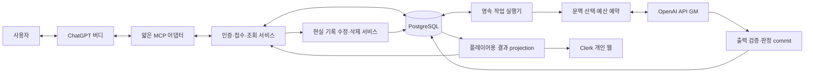
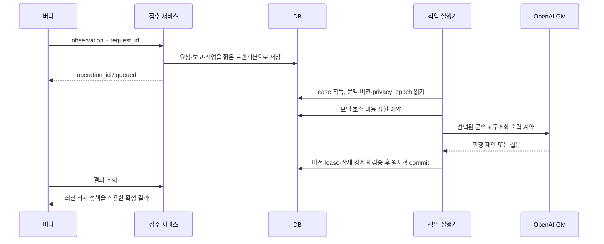

# LifeRPG v2 — 자율 성장형 AI GM 설계안

2026-10-15 · **설계 승인 / 1~2단계 기반 및 3단계 OpenAI adapter 구현**

진행 상태: 사용자가 기반 구현과 3단계 OpenAI 연결을 승인했다. 기본 reasoning은 medium으로 결정했다. 실제 동작·검증·남은 항목은 [v2 기반 구현 명세](V2-FOUNDATION.md), [OpenAI 연결 명세](V2-OPENAI.md)를 따른다. 아래의 전체 설계에는 아직 구현하지 않은 후속 단계도 포함된다. 실과금 호출·운영 배포는 승인 범위 밖이다.

이 문서는 사용자가 요청한 v2의 제안이다. 현재 동작은 [SPEC](../SPEC.md), 이전 설계 의도는 [기존 DESIGN](../DESIGN.md)에 남긴다. 승인 전에는 코드 구현, 운영 DB 변경, 유료 모델 호출, 배포를 시작하지 않는다. 기존 데이터 초기화와 서비스 중단은 허용되지만 이번 조사에서는 수행하지 않았다.

## 1. 제안의 핵심

**버디는 실제 사건을 전달하고 게임을 보여준다. 서버의 GM은 기억을 읽고 판단·창작한다. 서버의 실행기는 검증된 판정을 한 번만 반영한다.**

GM의 지속성은 API 대화 세션이 아니라 LifeRPG DB에 저장하는 정체성·기억·판정 이력으로 만든다. GM은 보상의 크기, 직업과 스킬, 세계 사건, 자신의 판단 철학을 발전시킨다. 인증, 현실 기록 통제권, 중복 방지, 데이터 제약, 비용 상한은 GM이 변경할 수 없다.

추천 구조는 **Node.js + TypeScript 모듈형 단일 서비스, PostgreSQL, 직접 OpenAI Responses API 호출**이다. MCP 어댑터와 작업 실행기는 같은 도메인 코드를 사용한다. 별도 마이크로서비스·벡터 DB·다중 GM·에이전트 프레임워크부터 도입하지 않는다. 기존 JS 파일을 모두 기계적으로 변환하지 않고 새 도메인부터 TypeScript로 작성한다.

이번 승인에서 합의할 기본값은 다음과 같다.

- 소유자별 게임과 GM 한 명. 현재 단일 소유자 운영은 유지하되 모든 데이터에 소유권 경계를 둔다.
- 현실 활동과 판타지 사건은 별도 원본이다. 판타지 모험은 현실 활동 없이도 진행할 수 있다.
- 일반 사건은 1회 모델 호출을 목표로 한다. 중복·조회·현실 수정·삭제의 필수 처리는 LLM 없이 가능하다.
- GM은 결과와 짧은 판단 이유, 명시적인 성찰을 기록한다. 모델의 비공개 내부 추론은 기억 원본으로 저장하지 않는다.
- 삭제는 판정보다 우선한다. 파생 기억의 출처가 불명확하면 보존보다 폐기를 선택한다.
- 자율성은 판단·창작·성찰의 자율성이다. 무접속 시간의 유료 주기 실행은 기본 비활성이다.

## 2. 코드 조사 결과와 재사용 판단

조사 기준은 로컬 Git `fa8b891` (`codex/phase8-release`)이다. 조사 시작 시 작업 트리는 깨끗했다. 운영 DB와 배포 상태를 이번에 조회하지 않았으므로 아래의 운영 이력은 저장소 문서에 기록된 사실과 구분한다. Developlog 프로젝트 목록에는 LifeRPG가 없어 저장소 문서·Git·코드를 근거로 삼았다.

| 영역 / 근거 | 현재 구현에서 확인한 내용 | v2 처리 |
| --- | --- | --- |
| `package.json`, `vercel.json`, `src/app.js` | Node 24, ESM JS + TypeScript 검사, MCP SDK, Zod, pg, Vercel HTTP 핸들러. MCP 함수 maxDuration 120초 | Node·MCP·Zod·Postgres 기반 재사용. HTTP 수명과 GM 작업 수명 분리 |
| `src/oauth.js`, `src/config.js` | 정적 클라이언트, PKCE S256, redirect/resource/scope 검증, grant 해시·refresh 회전. 고정 `experiment-owner` | 검증 패턴과 테스트 재사용. 사용자 ID 매핑과 v2 scope 재정의. 기존 write 권한으로 새 GM 호출을 조용히 허용하지 않음 |
| `src/web-auth.js`, `src/web.js` | Clerk 소유자 확인, MCP 소유자로 매핑, 조회 전용 웹 API | 인증과 웹 조회 자산 재사용. 신규 공개 projection·작업/비용 화면에 맞춰 DTO 교체 |
| `src/storage.js`, `migrations/002-*` | 사건 UUID·버전·이전 식별 alias, 요청 해시, 트랜잭션, 전역 advisory lock | 정체성·버전·재시도 패턴 재사용. 소유자별 잠금으로 변경. 삭제 가능한 원문 저장소로 재설계 |
| `src/growth-storage.js` | 게임 revision, 판정 체인, 근거 버전·효과 해시, XP/스탯 적용과 영수증의 원자적 저장 | 서버 내부 commit 엔진의 참고 구현. 버디가 호출하는 직접 변경 API는 제거 |
| `src/content-storage.js`, `src/quest-storage.js` | 정의 버전 고정, 획득 키, 소모 후 재지급 방지, 장착·부모/자식·종료 상태 검증 | 도메인 제약과 회귀 사례 재사용. 현실 할 일 원문은 판타지 퀘스트에서 분리 |
| `src/world-storage.js` | 엔터티·관계·정설/주장/믿음·기억·일지, 공개/GM projection | 개념·참조 검증 재사용. 자동 검색·출처 전파·기억 관리·GM 정체성은 신규 |
| `src/initialization-storage.js`, `migrations/007-*` | 준비 chunk와 최종 확정, 탄생·프로필 이력 | 준비/확정 패턴 재사용. chunk 생성은 서버 GM 담당. 탄생 원문도 삭제 예외 아님 |
| `src/tools.js` | 10개 도구. 긴 instructions가 “ChatGPT alone is the LifeRPG GM”을 선언. `apply_gm_update`가 게임 운영 지침까지 포함 | v1 외부 도구·instructions 폐기. 5개의 작은 v2 도구로 교체 |
| `src/growth-schema.js` | 6개 고정 스탯과 `growth-v1` 레벨 공식. 판정에 현실 사건 근거 최소 1개 필요 | 특정 규칙을 핵심 엔진에서 분리. 판타지 사건·퀘스트·이의 제기 자체도 판정 근거로 지원 |
| `migrations/001–008`, 감사/응답 저장 | 사실·근거·before/after·원본 입력·응답이 여러 테이블에 복제됨. 삭제를 막는 immutable trigger 존재 | 그대로 이식하지 않음. v2 새 스키마와 삭제 정책 설계. 기존 migration은 역사로 유지 |
| `test/*`, `scripts/client.js` | PGlite·공식 SDK 기반 테스트, 브라우저·운영 검증 분리 | 합성 fixture와 테스트 방식 재사용. 동시성·삭제는 실제 격리 Postgres에서도 검증 |
| 기존 운영 스크립트 | 특정 DB·배포·보존 이행 조건에 결합 | v2 전환 시 새 대상에 맞게 검토. 현재 스크립트의 무조건 실행 금지 |

기존 `DESIGN.md` 첫부분에는 Clerk 미도입·3개 도구 등 과거 시점 설명이 남아 있다. 현재 구조 판정은 이 문구보다 실제 코드와 최신 SPEC을 우선했다. README는 수정하지 않는다.

### 초경량 전달 실험에서 확인된 것

[실험 문서](OBSERVATION-EXPERIMENT.md), [배포 기록](DEPLOYMENT.md), `src/tools.js`, `test/server.test.js`를 대조했다.

- `{summary,test_id}`를 `tool_calls`에 기록하고 최초/중복 영수증을 반환한다. 외부 GM 호출과 게임 변경은 없다.
- 같은 ID에 다른 summary를 보내도 최초 건의 중복으로 처리한다. 호출마다 감사 행은 늘어나므로 현재 `idempotentHint:false`는 의도된 계약이다.
- 문서에는 운영 도구 등록·health/storage 검증이 기록돼 있다. **실제 ChatGPT의 이 도구 호출·자율 호출 성공은 해당 문서에서 확정되지 않았다.** 기존 `record_life_event` 자율 기록 성공과 혼동하지 않는다.
- 이번 조사에서 `node --test test/server.test.js`를 실행해 **11/11 통과**했다. 메모리 PGlite와 로컬 fetch 어댑터만 사용했다. 수신, 중복, 동시 요청, scope, 저장 실패 후 재시도가 포함된다. 운영 호출이나 v2 검증은 아니다.

v2는 “작은 payload → 확정된 수신 ID”를 계승한다. 다만 **같은 키·다른 payload는 충돌**, 수신과 판정 완료는 별도 상태, 감사 로그는 원문 없는 메타데이터로 바꾼다. 짧은 도구 설명이 클라이언트의 승인·차단 정책을 없앤다고 가정하지 않는다.

## 3. 전체 구조와 실행 환경



MCP와 LifeRPG 서버는 논리적 경계다. 최초 버전에서 별도 네트워크 서버 둘로 나눌 필요는 없다. 어댑터는 인증된 주체와 입력만 도메인 서비스에 넘긴다. GM은 DB credential, SQL, shell, 외부 URL 실행 권한을 받지 않는다.

**배포 기준안:** 같은 코드베이스에서 API와 worker를 별도 실행 역할로 구성한다. 개발 환경은 로컬 Node 프로세스 + 격리 Postgres, 운영은 프로세스 재시작·정기 깨우기·비밀 관리가 가능한 실행 환경을 요구한다. 현재 Vercel HTTP/정적 웹은 재사용할 수 있으나, 응답 후 떠 있는 Promise를 작업 보장으로 사용하지 않는다.

최초 worker는 Postgres `jobs`를 짧게 claim하고 lease·heartbeat·fencing token으로 재시작을 견디는 구조다. `SKIP LOCKED`는 작업 선점에만 사용하고 게임당 변경 작업은 한 번에 하나 실행한다. API/worker 분리는 배포 단위 분리를 강제하지 않는다. 지속 worker 호스팅과 기존 Vercel에서의 durable 실행 어댑터 중 실제 계정·비용·지연 조건을 구현 1단계에서 비교해 확정한다. 새 호스팅 비용은 별도 승인 전 지출하지 않는다.

Postgres를 유지하는 이유는 익숙함보다 **사건·판정·수치·작업·영수증을 같은 원자적 경계로 묶기 좋기 때문**이다. 서버가 소유하는 작은 상태 머신이면 현재 요구를 충족하므로 eve/Agents SDK/Workflow 도입은 필수가 아니다. 공급자 세션에 기억을 맡기는 방안은 모델 교체와 삭제 경계를 복잡하게 하므로 채택하지 않는다.

## 4. 버디와 MCP의 최소 계약

### 역할 계약

버디는 대화에서 확인한 본인 사건만 전달한다. 농담·소설·가정·미래 계획은 완료 사실로 보내지 않는다. 대화 전체·개인화 기억 전체를 덤프하지 않고 필요한 사실만 요약한다. ChatGPT가 안정된 메시지 ID나 모든 과거 기억을 제공한다고 가정하지 않는다.

서버는 전달문을 사용자에 대한 **보고된 사실**로 저장하며 독립 검증된 사실이라고 주장하지 않는다. 중요한 불확실성이 있으면 질문 상태로 둔다. 버디에게 보상·능력치·세계 설정의 변경 필드는 제공하지 않는다.

### 도구 5개

| 도구 | 최소 입력과 동작 | 권한 / annotation 제안 |
| --- | --- | --- |
| `submit_observation` | `request_id`, `summary`; 선택 `occurred_on`, `timezone`, `event_id`, `unknowns`. 현실 보고 접수와 GM 판정 작업 생성 | `life.write game.play`, readOnly=false, destructive=true, idempotent=true, openWorld=true |
| `interact_with_gm` | `request_id`, `kind: start/answer/appeal/action`, `message`; answer는 `question_id`, appeal은 `decision_id`, action은 선택 `scene_id` | `game.play`, false/true/true/true |
| `read_liferpg` | `view: status/request/records/game/usage`, 선택 ID·검색어·cursor. 저장된 정보만 조회 | 해당 `life.read` 또는 `game.read` 또는 `usage.read`, true/false/true/false |
| `revise_real_record` | `request_id`, `event_id`, `expected_version`, `summary`, 선택 발생일·불확실성. 사용자 정정을 즉시 반영하고 관련 판정을 재검토 대상으로 표시 | `life.write`, false/true/true/false |
| `delete_real_record` | `request_id`, `event_ids` 최대 20개. 현실 원문과 파생 기억 삭제 처리 시작·현재 삭제 상태 반환 | `life.delete`, false/true/true/false |

annotation 순서는 readOnly/destructive/idempotent/openWorld다. 수정·삭제 도구 자체는 외부 GM을 호출하지 않는다. 뒤따르는 게임 재해석은 별도 서버 작업이며 `game.play` 권한과 예산이 있을 때만 실행한다. **그 권한이나 예산이 없어도 사실 정정·삭제는 완료해야 한다.**

GM 호출 도구는 보상뿐 아니라 손실·상태 변화가 가능하므로 destructive=true, 외부 OpenAI 전송이 있으므로 openWorld=true로 명시한다. 실제 annotation·scope 형식은 구현 시 공식 MCP 계약과 클라이언트 연결로 검증한다. 힌트는 실행 권한을 대체하지 않는다. 기존 OAuth 재연결에서 확대된 권한을 명시한다.

도구 설명 초안은 다음 수준으로 제한한다.

> submit_observation: 확인된 현실 사건을 기록하고 외부 AI GM 판정을 요청합니다. 게임 상태가 변경될 수 있습니다. 재시도에는 같은 request_id와 입력을 사용하세요.

> delete_real_record: 사용자가 지정한 현실 기록과 관련 파생 기억을 삭제합니다. 게임 영향의 재해석은 별도로 진행되며 삭제를 막지 않습니다.

쓰기 도구는 strict schema, 알 수 없는 필드 거부, 문자열·배열·본문 상한을 적용한다. summary는 우선 1~1,000자, unknowns 최대 5개, message 최대 2,000자를 제안한다. 한 observation은 독립 사건 하나다. 한 번의 대화에서 여러 활동이 확인되면 별개 ID로 보낸다. 한국어 글자 수 제한과 모델 토큰 예산은 별도다.

```json
{
  "request_id": "obs-20261015-a71f",
  "summary": "오늘 30분 산책을 마쳤다.",
  "occurred_on": "2026-10-15"
}
```

미확인 날짜는 null/생략한다. 서버 수신 시각을 발생 시각으로 채우지 않는다. default timezone은 Asia/Seoul이며 사용자가 알려준 실제 발생 지역이 있으면 우선한다. `event_id`는 기존 기록을 보강한다는 힌트이며 존재·소유권을 검증한다. 기존 사실을 덮어쓰는 정정은 별도 도구로만 한다.

### 공통 응답과 질문·이의 제기

공통 envelope는 `request_id`, 서버 `operation_id`, `status`, `event_ids`, 선택 `decision_id`, `game_revision`, `player_result`, `question`, `retry_after_ms`, `error_code`다. 받는 상태는 `queued/running/needs_input/committed/no_change/blocked_budget/retryable_error/failed/deleted`로 제한한다. `accepted`라는 모호한 성공 하나로 판정 완료를 대신하지 않는다.

```json
{
  "request_id": "obs-20261015-a71f",
  "operation_id": "<server-uuid>",
  "status": "committed",
  "event_ids": ["<event-uuid>"],
  "decision_id": "<decision-uuid>",
  "game_revision": 12,
  "player_result": {
    "summary": "여행자의 걸음이 숲길의 흔적을 깨웠다.",
    "changes": [{"kind": "xp", "delta": 8}],
    "next_scene": "숲의 경계에서 작은 종소리가 들린다."
  }
}
```

예시의 판정·수치는 합성 설명이다. 실제 지급 규칙을 뜻하지 않는다. `changes`는 서버가 commit 결과에서 만들고, GM의 서사 문구와 함께 반환한다. 버디는 카드·진행바·대사·선택지로 연출하되 확정 수치를 변경하지 않는다. 클릭 가능한 UI는 기존 웹 또는 별도 MCP UI가 구현된 범위에서만 제공하며 텍스트 응답만으로 인터랙티브 UI 지원을 가정하지 않는다.

- 질문: `question_id`, 구체적 부족 사실, 선택적 답 후보, 관련 event/version을 반환한다. 버디가 이미 확인한 사실이면 답하고, 없으면 사용자에게 묻는다. 가상 선택지는 현실 확인 질문과 구분한다.
- 답변: 같은 질문에 같은 답은 재생; 다른 답은 충돌 또는 명시적 정정. 질문이 오래됐거나 대상이 수정·삭제되면 만료시키고 새 문맥에서 재검토한다. 답이 올 때까지 다른 독립 사건 처리는 막지 않는다.
- 이의 제기: 기존 decision을 참조한 별도 작업. GM은 유지·변경·추가 질문을 선택한다. 유지도 검토 결과로 기록하고 변경은 기존 판정 체인에 보정 delta로 반영한다. 사용자가 원하는 결과로 매번 재추첨하지 않는다.
- 판타지 행동: `kind:action`은 세계 안의 행동이다. 현실 활동 완료의 증거로 변환할 수 없다.
- 시작: `kind:start`로 최초 세계·캐릭터·GM identity를 준비한 뒤 원자적으로 확정한다. 미시작 상태에서 observation은 기록할 수 있으나 게임 생성 권한을 암묵적으로 얻지 않는다. 탄생에 이미 반영한 활동은 최초 보상을 소진한 것으로 기록한다.
- 결과가 늦으면 `queued`와 operation ID를 반환한다. 버디는 안내된 간격으로 조회하고 현재 대화에서 완료되지 않으면 다음 조회·개인 웹에서 이어 본다. 서버가 임의로 ChatGPT 대화에 알림을 밀어 넣을 수 있다고 가정하지 않는다.

## 5. 외부 GM 실행과 원자적 판정



빠른 작업은 HTTP 응답을 짧게 기다려 바로 committed를 반환할 수 있다. 대기 시간 초안은 8초이며 실제 클라이언트 측정으로 조정한다. **항상 DB 접수가 먼저**이고, 연결 종료가 작업의 취소·재생성을 뜻하지 않는다.

1. **접수:** 인증·권한·크기·요청 키 확인. 같은 `(owner_id, request_id)`와 같은 canonical payload면 기존 작업 반환. 내용이 다르면 `idempotency_conflict`. 신규 보고·요청·job은 함께 저장한다. 미확인 보고는 판정 근거로 승인되기 전 별도 상태다.
2. **사건 식별:** 명시적 event ID, 선택적 실제 source ref, 발생 기간·기존 사실로 후보를 검색한다. 정확한 재전송은 LLM 없이 종료한다. 표현만 다른 동일 사건과 같은 날 반복 활동은 구분 필요 시 GM이 식별하거나 질문한다. request ID는 사건 ID가 아니다.
3. **문맥 구성:** 현재 game revision, event versions, memory/identity revision, privacy_epoch, job fencing token을 고정한다. 실제 읽은 레코드 목록을 서버가 manifest로 기록한다.
4. **예산 예약:** 최대 입력·출력·수정 호출 비용을 예약한 후 요청한다. 예산이 없으면 사실 기록은 남기고 판정을 보류한다.
5. **OpenAI 호출:** Responses API + Structured Outputs. 공급자 저장을 피하기 위해 `store:false`; 매번 서버가 선택한 문맥을 제공한다. `previous_response_id`/Conversations 세션을 기억의 원본으로 사용하지 않는다. [공식 Responses 안내](https://developers.openai.com/api/docs/guides/migrate-to-responses)
6. **검증:** JSON schema에 이어 실제 ID·소유권·근거·정의 버전·수치·장착·퀘스트 상태·세계 관계·허용 작업·출력 크기를 검증한다. 거절·불완전 출력·시간 초과는 정상 실패 분기다. 구조화 출력만으로 의미 정확성이 보장되지는 않는다. [Structured Outputs](https://developers.openai.com/api/docs/guides/structured-outputs)
7. **commit:** 짧은 트랜잭션에서 대상 게임 잠금과 모든 read-set 버전을 재확인한다. 판정·수치 ledger·세계 변경·기억 변경·응답 참조·job 완료를 함께 저장한다. DB 트랜잭션을 잡은 채 API를 기다리지 않는다.
8. **결과:** commit 전 모델 원문을 확정 게임 결과로 내보내지 않는다. 응답 유실 시 같은 요청으로 재조회한다. 원문 응답 캐시를 그대로 재생하지 않고 삭제·비공개 projection을 다시 적용한다.

### GM 내부 출력 계약

`decision_kind: adjudicate/clarify/no_change`, 근거 event/version 또는 world-event/quest ID, 기존 판정 head, `public_summary`, `rationale`, typed `operations[]`, `memory_proposals[]`, 선택 `identity_reflection`을 받는다. 게임 변경은 `award_xp`, `adjust_stat`, `create_definition`, `grant_feature`, `change_inventory`, `transition_quest`, `create_world_event` 등 한정된 명령이다. 임의 SQL·실행 코드·무제한 JSON patch는 허용하지 않는다.

긴 세계 생성을 위해 서버 내부 준비 chunk를 사용할 수 있다. chunk는 미확정이고 공개하지 않으며, 최종 검증이 끝나야 탄생·세계 상태에 연결한다. GM이 추가 문맥을 요구하면 서버의 읽기 전용 검색을 1회 확장하고 전체 호출 수 제한 안에서 재시도한다. 자유로운 무한 tool loop를 만들지 않는다.

### 실패·중복·동시성

| 상황 | 보장 / 처리 |
| --- | --- |
| API 성공 후 worker가 DB 저장 전에 종료 | 호출 비용이 다시 들 가능성은 있음. job 재실행은 허용하되 게임 commit unique key로 효과 중복 금지. API까지 exactly-once라고 주장하지 않음 |
| 오래된 worker가 뒤늦게 응답 | lease의 fencing token과 privacy_epoch 불일치로 commit 차단 |
| 다른 사건이 먼저 게임 변경 | 게임 revision 충돌. 낡은 delta를 재적용하지 않고 새 문맥으로 제한된 재판정 |
| 모델 출력이 잘못된 참조·수치를 포함 | 구조 오류를 짧게 알려 1회 복구 기회. 한도 초과 시 failed; 부분 지급 없음 |
| 같은 사실을 새 요청 키로 다시 제출 | 의미 중복 후보를 비교. 확실하지 않으면 질문, 보상 보류. 임의 문장의 동일성 완전 판별은 보장 못함 |
| 같은 판정·아이템을 다른 표현으로 재발급 | 서버가 event base/quest occurrence/acquisition의 canonical 보상 권리를 관리. GM이 임의 aspect 문자열로 base 보상을 새로 만들 수 없음 |
| 예산·공급자 장애 | 이미 접수한 사건은 유지. 읽기·정정·삭제 가능. GM 성공으로 위장하지 않음 |
| 반복 작업이 답변 대기 | 게임 실행 lease를 반납. 답변 도착 때 새 작업으로 이어지고 같은 판정 head를 검증 |

보상 권리는 사건 최초 보상, 해당 사건의 새 정보에 대한 추가 판정, 퀘스트 발생 회차, 독립 세계 사건 등으로 구분한다. 현실 정정·이의 제기는 원래 권리에 대한 보정이다. “새 업적”을 통해 같은 현실 보상을 우회하는 의미 중복은 서버 제약만으로 완벽히 막을 수 없으므로 관련 판정 검색과 평가 사례로 감시한다.

## 6. 장기 기억과 성장하는 GM

### 기억 계층

| 계층 | 내용 | 갱신·검색 방식 |
| --- | --- | --- |
| 운영 헌장 | 현실/창작 구분, 사용자 기록 통제, 권한·예산·무결성 | 코드/운영자 버전. GM 수정 불가 |
| GM 정체성 | 이름·말투·가치관·판정 철학·창작 취향·관심 주제 | GM 제안으로 versioned 저장. 모델 ID와 독립 |
| 현재 게임 상태 | 캐릭터, 보유물, 활동 중 퀘스트, 장소, 장면, 관계 | 트랜잭션 원본. 기억 요약으로 대체 불가 |
| 일화 기억 | 보고된 실제 활동, 세계 사건, 판정·짧은 이유, 만남 | 출처·종류·공개 범위·버전·관련 ID 보유 |
| 장기 요약 | 퀘스트별 흐름, 세계 설정, 플레이 스타일 | 원본 목록과 요약 버전 저장. 삭제·정정 시 무효화 가능 |
| 성찰 | 관찰한 판단 경향, 바꾸려는 원칙, 변화 이유 | 성찰별 근거·채택 시점·이전 정체성 참조 |

**현실에 대한 기억, 허구의 정설, NPC의 주장, GM의 해석은 서로 다른 종류**다. 장기 요약에서 추측이 현실 사실로 승격되지 않도록 타입을 유지한다. GM의 정체성은 지속적인 서사·판정 상태이며 실제 의식·모델 가중치 학습을 주장하지 않는다.

### 문맥 선택

기본 문맥은 헌장·현행 정체성·캐릭터·현재 장면·관련 퀘스트·직전 주요 판정이다. 사건별로 관련 인물·장소·과거 판정·미해결 복선을 ID 연결과 DB 검색으로 추가한다. 고정 중요도만 쓰지 않고 관련성·미해결 여부·최근성·중요도를 함께 점수화한다. 항상 포함할 정설·금지된 모순과 단순 최근 로그를 구분한다.

초기 예산안은 입력 최대 12,000토큰, 출력 최대 3,000토큰이다. 실제 모델의 reasoning 포함 여부와 지원 설정에 맞춰 capability profile을 검증한다. 초과 시 낮은 우선순위 기억부터 생략하고 `context_omissions`를 남긴다. 필요한 핵심 근거가 잘린 상태로 확정 판정하지 않는다. 한국어 검색은 ID·태그·문자열 검색부터 시작하고 품질 측정 뒤 pgvector 등을 검토한다. 매 사건 임베딩 호출은 기본으로 하지 않는다.

검색은 삭제/권한 필터를 먼저 적용한다. 모든 생성물은 GM이 주장한 source IDs뿐 아니라 **실제로 입력한 문맥 전체의 현실 출처 집합을 보수적으로 상속**한다. 요약을 다시 요약하거나 정체성으로 반영해도 이 집합을 전파한다. 이를 통해 모델이 출처를 빠뜨려도 삭제 경로를 잃지 않는다. 대신 출처 집합이 커져 삭제 범위가 넓어지는 비용을 수용한다.

### 성찰과 성격 변화

평소 판정에 작은 성찰 후보를 함께 반환할 수 있다. 의미 있는 사건·이의 제기·장편 퀘스트 종료 또는 누적된 후보가 있을 때만 정체성 갱신 작업을 수행한다. 매 사건마다 별도 자기반성 LLM을 호출하지 않는다.

예: “성과의 규모보다 꾸준함을 더 인정하기로 했다”는 앞으로의 보상 철학 변화다. “사용자가 싫어하면 무조건 보상을 올린다”는 요구를 자동 수용하지 않는다. 새 정체성은 관련 근거·달라진 점·적용 범위·version을 가진다. 과거 판정의 수치를 소급 수정하려면 별도 보정 판정이 필요하다. 헌장·도구 권한·예산 변경은 identity patch로 통과할 수 없다.

모델 교체 시 같은 GM ID·정체성·세계·기억을 새 모델에 공급한다. 합성 사건·과거의 개인정보 없는 평가 예제로 일관성·서사·질문 빈도·비용을 비교하고 선택한다. 단순 model 이름 교체로 동일한 성격이 완벽히 재현된다고 보장하지 않는다. 모델·prompt·출력 schema 버전을 판정마다 기록해 변화 원인을 구분한다.

### 현실과 독립적인 세계 진행

일상 사건은 세계에 계기를 제공하지만 모든 판타지 퀘스트에 현실 할 일을 붙이지 않는다. 사용자의 `action`이나 다음 접속 때의 제한된 catch-up으로 NPC 계획·분쟁·탐험이 진행될 수 있다. 세계 사건에는 현실 event FK가 없어도 된다. NPC가 임무를 마쳤다는 창작을 사용자의 현실 성취로 저장하지 않는다.

서버는 `world_clock`, 마지막 진행 시각, 예정된 세계 사건을 저장한다. 다음 상호작용에서 GM이 경과를 해석하며 한 번에 처리할 장면 수를 제한한다. 초기에는 무접속 시간을 이유로 자동 현실 XP를 주거나 손실을 적용하지 않는다. 장기 미접속 중 세계가 실제로 계속 실행되도록 하는 scheduler는 별도 옵션이며, 도입 시 빈도·월 예산·휴면 중 불이익 정책을 합의한다.

## 7. 현실 기록 수정·삭제와 세계 재해석

### 원칙과 가장 중요한 설계 변경

현실 기록의 정정·삭제는 사용자 명령이다. GM은 거부하거나 설득 조건을 달 수 없다. 게임 영향은 GM이 판단하되, 삭제된 원문을 GM에게 다시 보여주며 “익명화해 달라”고 맡기지 않는다. 이름만 바꾼 가상 사건이 재식별 가능한 정보라면 보존할 수 없다.

원본과 식별 가능한 파생 텍스트는 **삭제 가능한 payload**로 분리한다. 판정/ledger의 안정된 ID·수치와 payload 포인터를 분리해 텍스트 삭제 후에도 게임 정합성을 유지한다. 현실 내용이 섞일 수 있는 이유·설명·요약·질문·응답·정체성·탄생 설정도 모두 payload 대상이다. 변경 이력이 있다는 이유로 삭제에서 제외하지 않는다.

### 수정 흐름

사용자가 사실을 고치면 expected_version 검증 후 즉시 새 현재 사실을 저장한다. 기존 내용과 상충하는 기억·요약·미실행 판정은 무효화하고 관련 게임 재검토를 예약한다. GM은 현실 정정 자체를 되돌릴 수 없다. 평범한 정정 이력도 사용자 통제 범위이며 “이전 내용도 지워 달라”면 같은 삭제 절차를 적용한다. 역사 보존을 위해 원하지 않는 원문을 영구 강제 보관하지 않는다.

### 삭제 프로토콜

1. **대상 확정:** 인증된 사용자가 지정한 event IDs를 검증한다. “그 운동 기록”처럼 대상이 모호하면 조회로 후보를 보여주고 범위만 확인한다. 삭제 이유는 필수가 아니다.
2. **차단 트랜잭션:** `privacy_epoch`를 올리고 대상·파생 출처 집합을 삭제 차단 목록에 넣는다. 신규 문맥 선택과 모든 읽기·결과 재생은 차단 목록을 적용한다. 관련 job·질문·준비 chunk를 취소/무효화한다. 물리 삭제가 오래 걸리더라도 이 시점부터 대상 내용은 노출하지 않는다.
3. **동시 실행 차단:** 모든 GM commit은 privacy_epoch를 다시 확인한다. 삭제 이전 문맥으로 나온 늦은 응답은 내용 저장·commit을 폐기하고 메타데이터 사용량만 남긴다. 삭제는 실행 중인 LLM 응답을 기다리지 않는다. 이미 외부로 전송된 요청을 소급 회수할 수는 없다.
4. **파생물 정리:** 현실 원문·버전·alias 텍스트·보고·질문·검색 인덱스·요약·판정 이유·GM 성찰/정체성·판타지 설명·응답 payload·작업 중간값까지 출처의 전이 폐쇄로 제거한다. 명시적 event 링크가 없어도 문맥 상속 출처로 걸러낸다. 출처가 누락되거나 신뢰할 수 없으면 해당 범주의 요약/정체성을 통째로 무효화한다.
5. **즉시 안전 상태:** 식별 가능한 게임 텍스트는 제거하고 중립적인 임시 표시와 필요한 비식별 수치만 남긴다. 유지하는 수치 조합이나 metadata도 재식별 위험이 있으면 일반화/제거한다. 삭제된 항목을 참고하는 보상·퀘스트는 `needs_reinterpretation`으로 둔다. GM 장애 시 이 상태로 안전하게 유지한다.
6. **선택적 재해석:** GM에 오염되지 않은 세계 설정과 허용된 추상 게임 상태만 제공한다. 관련 보상 제거·유지·조정 또는 새 허구 사건 치환 중 선택하게 한다. 안전한 추상 상태를 만들 수 없으면 관련 서사와 의존 기억을 폐기하고 깨끗한 정체성에서 이어간다. 삭제된 사건의 날짜·장소·이름·특이한 세부 묘사를 재해석 프롬프트에 넣지 않는다.
7. **완료 영수증:** 삭제 대상의 무작위 ID, 상태, 처리 시각, 정리한 객체 수, 백업 잔존 정책만 남긴다. 삭제 원문·검색 가능한 특징·원문 content hash를 감사용으로 보존하지 않는다. 요청 키 재시도는 `deleted`라는 비내용 영수증을 반환한다.

이 절차는 삭제된 텍스트를 LLM으로 익명화하면 안전하다는 가정에 의존하지 않는다. 보수적 출처 전파 때문에 오래된 사건 하나가 넓은 GM 기억·개성 변화까지 제거할 수 있다. **완벽한 GM 기억 보존보다 사용자 삭제권을 우선**한다. 일반 원칙처럼 보이는 성찰도 출처가 삭제 대상이면 기본적으로 폐기하고 깨끗한 근거로 새로 학습한다.

### 재유입·백업·외부 보존의 경계

- 삭제된 event/operation ID는 비내용 tombstone으로 차단한다. 오래된 요청·판정·복원본을 재생해 현실 기록이 살아나지 않게 한다. 요청 원문의 해시 등 파생 식별 정보도 삭제한다. tombstone에 해당하는 ID 재요청은 내용 비교 없이 deleted로 종료한다.
- 기존 사실을 전혀 다른 문구·새 ID로 다시 보내면 서버가 삭제 원문 없이 완벽히 동일성을 알아낼 수는 없다. 버디는 삭제 후 과거 대화·기억에서 자동 재수집하지 않아야 한다. 사용자가 분명히 새로 기록하겠다고 한 사실만 신규 보고로 받는다. 삭제 직후에는 과거 사건 자동 수집을 중지하고 버디에 그 상태를 돌려준다. 이를 기술적으로 모든 표현에 보장한다고 주장하지 않는다.
- 라이브 DB 삭제와 **백업/PITR/WAL/복제본**의 완전 만료는 구분한다. 제공자별 보존 기간·삭제 가능성을 운영 전 확인하고 화면에 `live_purged`, `backup_expiry_pending`, `fully_expired`를 구분한다. 백업의 해당 행을 즉시 없앨 수 없다면 완전 삭제라고 보고하지 않는다. 즉시 복구 불가능한 삭제가 요구되면 별도 키 저장소를 포함한 암호화·키 폐기 설계를 도입한 뒤 출시한다.
- 복구는 격리 환경에서 하고, 복구 DB와 별개로 보존한 삭제 tombstone/epoch를 먼저 적용한 뒤 serving을 허용한다. 테스트·branch·dump·관측 로그에도 동일한 삭제 정책을 적용한다. 운영 원문을 개발 fixture로 복사하지 않는다.
- `store:false`는 모든 공급자 보존이 없다는 뜻이 아니다. OpenAI의 기본 abuse monitoring 보존 및 별도 승인되는 데이터 제어를 확인해야 한다. 서버는 자기 저장소의 삭제 범위와 외부 보존 한계를 구분해 안내한다. [OpenAI 데이터 제어](https://developers.openai.com/api/docs/guides/your-data)
- ChatGPT의 과거 대화·개인화 기억은 이 서버의 삭제 권한 밖이다. 서버는 삭제 결과와 재수집 금지를 버디에 전달할 수 있으나 ChatGPT 계정 기록까지 삭제했다고 주장하지 않는다.

## 8. DB와 게임 상태 모델

v2는 별도 schema/DB에 새로 구성한다. 현행 데이터 이전은 필수가 아니다. 다만 인증 credential과 플랫폼 설정은 게임 초기화와 분리한다. 현재 운영 데이터는 승인된 전환 때 정리하며, 이번 설계 단계에서는 그대로 둔다.

| 영역 | 주요 테이블 초안 | 핵심 제약 |
| --- | --- | --- |
| 게임 | `games`, `characters`, `rulesets`, `stat_definitions`, `character_stats` | owner/game, revision, privacy_epoch. 숫자 범위·단위·ruleset version 검증 |
| 접수 | `requests`, `observations`, `jobs`, `job_attempts`, `questions` | owner+request unique, payload 참조, lease/fencing, 작업 상태 전이 |
| 현실 | `real_events`, `real_event_versions`, `event_aliases` | 소유권·event version·시간 정밀도. 원문 삭제 가능 |
| 판정 | `decisions`, `decision_sources`, `reward_entitlements`, `effect_ledger` | 현재 head, 보상 권리 unique, commit ID unique. 보정 delta로 잔액 계산 |
| 게임 콘텐츠 | `definitions`, `definition_versions`, `features`, `inventory`, `questlines`, `quests`, `quest_occurrences` | 버전 고정, 획득 키, 장착 참조, 회차별 완료·보상 |
| 세계 | `world_entities`, `world_relations`, `world_events`, `world_facts`, `world_clock` | game 범위 FK, 정설/주장 구분, 현실 근거 없이도 존재 |
| GM | `gm_identities`, `gm_identity_versions`, `memories`, `memory_sources`, `reflections` | 정체성의 모델 독립성, 출처·공개 범위·무효화 상태 |
| 개인정보 | `content_payloads`, `content_dependencies`, `deletion_requests`, `deletion_tombstones` | 모든 민감 텍스트의 삭제 경계와 전이 출처. 읽기 시 epoch/차단 적용 |
| 비용 | `model_profiles`, `model_runs`, `budget_reservations`, `usage_ledger`, `price_versions` | 호출별 최대 비용 예약·실사용 정산·공급자 요청 ID, 원문 없음 |

구체적 엔터티는 관계형 컬럼과 composite FK로 같은 game/owner 범위를 강제한다. GM이 만드는 설명과 유형별 설정만 제한된 JSONB로 보관한다. `content_payloads`는 개인정보 삭제를 위한 공통 저장 경계이며 모든 도메인 엔터티를 한 JSON 테이블로 대체하는 구조가 아니다. 출처/의존 그래프는 삽입 시 서버가 검증한다.

ledger와 현재 projection을 같은 트랜잭션으로 저장한다. 모든 과거 원문을 재생해야만 현재 상태를 만들 수 있는 순수 event sourcing은 피한다. 삭제 후에는 비내용 ledger와 정리된 snapshot으로 복구할 수 있어야 한다. 운영 진단 로그는 operation/model run ID·status·지연·토큰·비용만 남긴다. 현재 `safeArguments`처럼 summary/evidence를 감사 JSON에 복제하지 않는다.

### 규칙과 GM의 권한

초기 ruleset으로 기존 6개 스탯과 XP 곡선을 채택하는 것은 가능하지만 고정 핵심 규칙으로 강제하지 않는다. GM은 지원되는 수치 타입·단위·상한을 가진 스탯과 명시적 레벨 문턱을 제안할 수 있다. 정의는 versioned이며 레벨 문턱의 증가성·음수/overflow·참조 일관성은 서버가 검증한다. 임의 수식을 코드로 실행하지 않는다.

보상량·성장 속도·새 직업·능력·아이템·퀘스트·NPC는 GM의 판단이다. 새로운 계산 연산자가 필요한 효과는 우선 서사 효과로 표현하며 계산 기능 추가는 구현 범위 변경으로 검토한다. 규칙 변경은 명시적 ruleset 개정과 이전 상태 전환 계획을 통해서만 적용해 모든 기존 수치가 조용히 재해석되지 않게 한다. 이는 사용자에게 매 보상을 승인받는 절차가 아니다.

GM 비공개 기억은 버디용 응답에 넣지 않는다. 기존 `view=gm` 공개 도구는 폐기한다. 같은 소유자의 관리 기능으로 원본을 볼 수 있는지와 게임 플레이 중 스포일러를 보여줄지는 별도 권한·화면으로 정한다. payload의 공개 범위만 바꿔 현실 정보를 가상 정보로 세탁할 수 없다.

## 9. 모델과 비용 운영

모델 이름은 소스 코드의 단일 상수보다 `model_profiles` 설정으로 관리한다. 프로필에는 provider/model ID, 지원 schema·reasoning 설정, 입출력 한도, timeout, 가격 버전, 사용 가능 여부를 둔다. 초기에는 한 GM 모델로 품질을 측정하고, 성찰·요약용 저비용 모델 분리는 필요가 확인된 뒤 검토한다. 특정 최신 모델을 추측해 기본값으로 고정하지 않는다.

API 키는 서버 비밀 환경변수 `OPENAI_API_KEY`로만 주입한다. MCP 입력·웹 번들·DB 일반 설정·로그에 넣지 않는다. 예산·결제·키 발급은 사용자가 관리한다. 모델의 기본 프로필이나 fallback 변경이 비용을 올리면 사전 합의가 필요하다. fallback은 승인된 목록 안에서만 사용하고 사용 모델을 기록한다.

비용 대시보드에는 일/월·모델·작업 종류별 호출 수, 입력/출력/캐시 토큰, 추정 비용, 미정산 비용, 실패·재시도 비용을 표시한다. 공급자 usage에 포함된 reasoning을 출력 토큰에 또 더해 중복 계산하지 않는다. 캐시 쓰기 등 모델별 항목은 해당 가격 체계에 맞춰 별도 처리한다.

일반적인 추정식은 `Σ(각 청구 토큰 수 × 해당 모델·시점의 단가 / 1,000,000)`이다. 월 300건, 건당 입력 8,000·출력 1,500토큰인 **계산 예시**라면 캐시·재시도·성찰을 제외하고 `2.4 × 입력 백만 토큰 단가 + 0.45 × 출력 백만 토큰 단가`다. 실측 비용 예측이나 현행 가격 인용은 아니다.

| 비용 제어 | 제안 |
| --- | --- |
| 요청 예산 | 일반 GM 1회 목표. 문맥 확장·schema 복구·충돌 재판정을 합쳐 논리 작업당 최대 3회 API 시도. SDK 자동 재시도도 포함해 계수 |
| 월/일 한도 | `지출 추정 + 미정산 보수 예약 + 이번 최대 예약 <= 사용자 한도`를 DB에서 원자적으로 확인 |
| timeout/응답 유실 | 호출이 과금되지 않았다고 가정하지 않음. usage 불명이면 예약을 유지하고 조정 가능하도록 표시 |
| 동일 요청 | 저장된 결과/작업 재사용. 조회와 polling은 모델을 호출하지 않음 |
| 문맥 | 관련 기록만 선택. 매번 전체 연대기·전체 GM 일기 전송 금지 |
| 성찰·세계 경과 | 사건마다 별도 호출하지 않고 중요한 변화에 묶음. idle loop 기본 꺼짐 |
| 캐시 | 정적인 헌장·schema를 앞에 배치하되 실제 적중량으로만 절감 계산. 보존 정책은 모델·계정에서 확인 |
| 예산 소진 | GM 작업 보류, 사용자에게 이유 표시. 무료인 척 로컬 가짜 판정으로 대체하지 않음 |

프롬프트 캐시는 공유 접두부 재사용이며 영속 기억이 아니다. 캐시 적중·보존·단가는 모델별로 다를 수 있다. 민감 문맥의 보존 정책을 비용 절감보다 우선한다. [Prompt caching](https://developers.openai.com/api/docs/guides/prompt-caching)

서비스에서 계산하는 수치는 **추정 비용**이다. 공급자 청구 비용과 대조하려면 사용자가 대시보드를 확인하거나, 추후 별도 관리자 권한으로 Costs API를 연결한다. 일반 GM 키에 관리 권한을 추가하지 않는다. 서비스의 예산 예약은 이 서비스의 호출만 제한하며 같은 키/프로젝트를 쓰는 다른 앱의 지출까지 통제하지 않는다. [OpenAI Costs API](https://developers.openai.com/api/reference/resources/admin/subresources/organization/subresources/usage/methods/costs)

## 10. 단계별 구현 계획과 완료 기준

| 단계 | 구현 범위 | 다음 단계로 가기 위한 검증 |
| --- | --- | --- |
| 0. 설계 승인 | 이 문서의 권한·기억·삭제·기본 세계 진행 방식 합의 | 2026-10-15 사용자 승인 완료 |
| 1. 기반과 계약 | 새 스키마, TypeScript 도메인, MCP 5개, owner/scope, 가짜 GM, jobs·영수증·비용 예약. 실행 호스트 결정 | 외부 API 없이 접수/중복/충돌/재시작/권한 검증. 원문을 감사 로그에 남기지 않음 |
| 2. 삭제 가능한 상태·기억 | payload/출처 전파, 삭제 경계, 수정, 정체성·기억 모델, backup 복원 차단 | 삭제와 in-flight commit 경합, 오래된 영수증/질문/요약/정체성/탄생 기록을 통한 원문 복원 차단. 이 단계 이전 실제 개인정보 LLM 전송 금지 |
| 3. GM 최초 연결 | OpenAI adapter, structured proposal, 문맥 builder, commit validator, 사용량 | 사용자가 키·한도 설정 후 승인한 소액 합성 평가. timeout/거절/불완전 JSON·budget 경합 검증 |
| 4. 완전한 게임 흐름 | 탄생, 현실 활동 판정, 직업/능력/아이템/퀘스트, 독립 세계 행동, 질문·이의 제기 | 접수→판정→영속 상태→버디/웹 결과 일치. 보상 재시도·소모 후 재지급·판정 보정 검증 |
| 5. 장기 성장·표현 | 기억 압축·성찰·정체성 개정, 모델 교체 평가, 결과 카드·비용/작업/삭제 화면 | 긴 합성 캠페인에서 정설·삭제·비용·성격 연속성 평가. 질문 남발·보상 아첨·서사 붕괴 점검 |
| 6. 운영 전환 | 기존 writer 차단, v2 schema, 재연결, 필요 시 기존 게임 초기화, 배포 | 실제 ChatGPT 최소 호출·조회·질문·이의 제기·삭제 실사용 확인. v1 도구/옛 배포 우회 쓰기 차단 |

단계 1–2에서는 mock GM과 합성 데이터만으로 구조를 검증할 수 있다. 개발 중 배포·유료 호출은 이번 설계 승인에 포함되지 않으며 실제 필요 시 준비된 대상과 비용 한도로 승인받는다. 운영 전환 시 기존 데이터 보존은 필수가 아니지만 코드 기준점·전환 절차는 남긴다. 삭제된 기록이 들어 있는 백업으로 돌아가는 rollback은 허용하지 않는다.

필수 자동 검증은 요청 중복과 payload 충돌, 동시 worker/lease 탈취, API 응답 유실, commit 직전 수정·삭제, 정의·장착·퀘스트 제약, 답변 중복·만료, 이의 제기 보정, 숨김 데이터 노출, 모델 교체, 비용 예약 경합이다. PGlite 테스트 외에 격리된 실제 Postgres에서 잠금·중복 commit·복원 절차를 확인한다. 모델 품질 평가는 개인정보 없는 사례로 하고 실제 사용자의 대화/기억을 자동 평가 자료로 수집하지 않는다.

## 11. 주요 위험과 출시 판단

| 위험 | 영향 | 대응과 남는 한계 |
| --- | --- | --- |
| 버디가 사건을 놓치거나 허구를 전달 | 잘못된 현실 기록·보상 | 작은 역할 계약·사용자 정정·부족 사실 질문. MCP만으로 대화 관찰 정확도를 보장할 수 없음 |
| 의미 중복 | 반복 보상 | canonical 권리·후보 검색·판정 체인. 새 표현의 의미 동일성은 모델 오류 가능 |
| 프롬프트 주입 | GM 권한·서사 오염 | 모든 사건/기억을 데이터로 취급, 서버 헌장 분리, typed proposal 검증. GM이 SQL·예산·삭제 규칙 변경 불가 |
| 삭제의 파생 오염 | 원문이 요약·성격·세계사로 잔존 | 서버 문맥 출처 상속·보수적 폐기·재생 시 필터. 기억 손실을 감수하며 삭제 품질을 출시 차단 기준으로 삼음 |
| 공급자·백업 잔존 | 즉시 전체 삭제 불가 | live/backup/provider 경계 공개. 실제 보존 기간 확인 전 무보존 약속 금지 |
| GM의 아첨·극단적 성향 변화 | 게임 신뢰·성격 연속성 저하 | 근거가 있는 성찰·이의 제기 평가·versioned 정체성. 보상 정책을 고정 계산기로 환원하지 않음 |
| LLM 지연/실패/동시성 | 작업 유실·오래된 판정 적용 | DB 작업 상태·lease/fencing·revision·privacy_epoch·재시도 한도 |
| 장기 문맥/비용 증가 | 한도 초과·기억 누락 | 관련 검색·요약 출처·token cap·비용 예약. 핵심 근거가 없으면 질문/보류 |
| 오래된 v1 writer | 외부 GM 권한 우회 | v2에서 직접 `apply_gm_update` 제거, 이전 연결·배포 쓰기 경로 폐쇄 |
| 초기 구현 범위 팽창 | 게임을 보기까지 지연 | 1인 1세계·1GM·수동/접속 시 세계 진행·Postgres 검색부터 시작 |

승인 후에도 운영 전에 확정해야 할 항목은 **실제 모델과 월 예산, worker 실행 호스트와 비용, 백업/공급자 보존의 허용 범위**다. 이는 구현을 미리 시작하기 위한 빈칸이 아니라 운영 환경의 실제 조건을 확인할 지점이다. 기본 제품 방향과 DB·기억·처리 계약은 위 제안으로 검토할 수 있다.

## 12. 최초 설계 작업의 산출물과 검증 경계

- 산출물: 이 설계안과 기존 DESIGN에서의 안내 링크. 구현 코드·migration·환경설정·README·SPEC 변경 없음.
- 조사: 로컬 코드·migration·테스트·Git·운영/실험 문서, OpenAI 공식 문서. 운영 DB 접속·실제 GM 호출·배포 없음.
- 실행 검증: 기존 서버 테스트 11/11. 설계의 v2 동작·성능·모델 품질·운영 비용은 아직 검증하지 않음.
- 당시 다음 행동: 사용자 검토와 승인. 이후 승인된 1~2단계 결과는 문서 상단 링크를 따른다.
